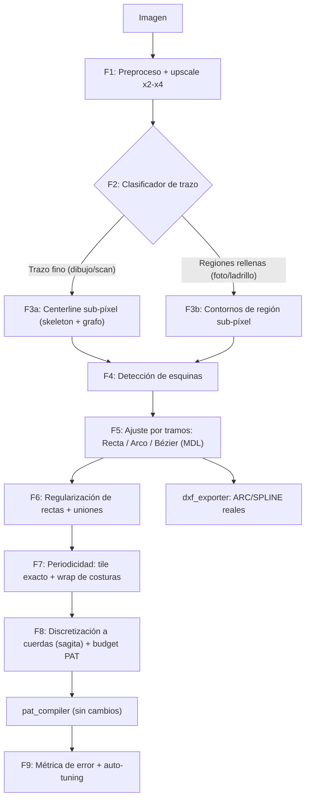

# Plan: Vectorización de precisión (rectas + orgánicas) estilo Vector Magic para HatchIt

## 0. Diagnóstico del pipeline actual

Revisé [core_logic.py](file:///d:/Hatch/HatchCraftAI/core_logic.py), [geometry.py](file:///d:/Hatch/HatchCraftAI/geometry.py), [segment_cleaner.py](file:///d:/Hatch/HatchCraftAI/segment_cleaner.py) y [metrics.py](file:///d:/Hatch/HatchCraftAI/metrics.py). Estos son los puntos que hoy limitan la precisión:

| # | Problema | Dónde | Efecto visible |
|---|----------|-------|----------------|
| 1 | **Canny sobre trazos dibujados** devuelve los **dos bordes** de cada línea | `_preprocess` | Líneas dobles, que después se intentan arreglar con dedup heurístico |
| 2 | **Coordenadas enteras de píxel** (`findContours` + `CHAIN_APPROX_SIMPLE`, Hough) | `convert()` L514-566 | Rectas que salen 1–3° torcidas, curvas en "escalera" |
| 3 | **Tolerancia RDP relativa** `epsilon * arc_len` | L559-560 | Las curvas grandes quedan toscas y las chicas sobresegmentadas |
| 4 | **No se distingue recta, arco y curva libre**: todo pasa a polilínea | detección | Las orgánicas se ven "facetadas" y las rectas acumulan vértices de más |
| 5 | **No hay detección de esquinas** | — | Las esquinas se redondean y las curvas se quiebran en lugares arbitrarios |
| 6 | **No se regularizan rectas** (paralelismo, ortogonalidad, colinealidad, uniones) | — | Juntas de ladrillo que no son exactamente paralelas ni cierran en T/L |
| 7 | `max_resolution=600` y upscale solo si el lado es <200 | L453-462 | Se pierde la precisión sub-píxel antes de empezar |
| 8 | El período (`detect_period`) se calcula **pero no se usa** | L676 | El tile no coincide con la repetición real y hay costuras en Revit |
| 9 | No hay un **error objetivo** imagen↔vector | — | Los parámetros se ajustan a ojo, con sliders |

---

## 1. Cómo funciona Vector Magic / Potrace (lo que vamos a replicar)

1. **Segmentación por regiones** (no por bordes): se cuantiza el color y cada región tiene un contorno cerrado y compartido con sus vecinas.
2. **Bordes sub-píxel**: el contorno se calcula sobre la imagen suavizada (iso-línea), no sobre píxeles discretos.
3. **Detección de esquinas** por curvatura o ángulo (el parámetro `alphamax` de Potrace).
4. **Ajuste por tramos** entre esquinas: se elige **recta** o **curva Bézier** minimizando *error + complejidad* (criterio MDL).
5. **Optimización global**: se fusionan tramos mientras el error se mantenga bajo tolerancia.
6. **Nivel de detalle** (Low/Medium/High), que en la práctica es una sola tolerancia.

**Restricción propia de HatchIt:** un `.PAT` **solo admite rectas**. Por eso las curvas se ajustan con precisión (arco o Bézier) y **después** se discretizan en cuerdas con un error controlado (sagita). Así se evita aproximar con cuerdas directamente sobre píxeles ruidosos.

---

## 2. Arquitectura propuesta



Módulos nuevos (los actuales se mantienen; esto se agrega como un `method="precision"` nuevo):

```
HatchCraftAI/
├── vectorize/
│   ├── preprocess.py      # F1
│   ├── classify.py        # F2
│   ├── centerline.py      # F3a
│   ├── regions.py         # F3b
│   ├── corners.py         # F4
│   ├── fitting.py         # F5 (amplía geometry.py)
│   ├── regularize.py      # F6
│   ├── periodic.py        # F7
│   ├── discretize.py      # F8
│   └── pipeline.py        # orquestador
└── metrics.py             # F9 (se amplía)
```

---

## 3. Fases en detalle

### F1 — Preprocesado de alta fidelidad
- **Resolución de trabajo**: subir `max_resolution` a **1600–2000 px** y hacer upscale **×2 a ×4 con `INTER_CUBIC`** cuando la imagen sea de menos de ~800 px. El sub-píxel necesita muestras.
- **Corrección de iluminación**: dividir por el fondo estimado (`gray / GaussianBlur(gray, σ grande)`). Rinde mejor que CLAHE en scans con sombra.
- **Binarización robusta** (para trazos): **Sauvola** (`skimage.filters.threshold_sauvola`) en lugar de `adaptiveThreshold`.
- **Suavizado que preserva bordes**: bilateral, o difusión anisotrópica Perona-Malik.
- **Fotos de materiales**: cuantización de color con **k-means en espacio Lab** (K=2–6) antes de buscar regiones, como hace Vector Magic.
- **Opcional (fotos difíciles)**: detector de bordes neuronal liviano **TEED / PiDiNet en ONNX** (~1 MB), que reemplaza a Canny cuando hay mucha textura.

### F2 — Clasificador automático de tipo de trazo
- Calcular el ancho de trazo con `distanceTransform` sobre la máscara **binaria** (no sobre Canny, como hoy en `_estimate_stroke_width`).
- Regla: si el ancho es bajo y **uniforme** (CV < 0.35) y la tinta ocupa menos del ~25 % del área → **modo centerline**. Si no → **modo región**.
- Esto resuelve el problema #1 (bordes dobles) desde la raíz, y además se puede forzar manualmente en la UI.

### F3a — Centerline sub-píxel (dibujos y scans)
1. Esqueleto con `skimage.morphology.skeletonize` (método Zhang/Lee) sobre la máscara binaria.
2. **Grafo del esqueleto**: nodos en extremos (grado 1) y en uniones (grado ≥ 3), aristas = cadenas de píxeles. Se puede usar `skan` o implementarlo en unas 80 líneas.
3. **Poda de espolones**: borrar ramas terminales más cortas que ~1.5 × ancho de trazo.
4. **Cierre de gaps**: unir extremos cercanos cuya dirección tangente sea compatible (ángulo < 20° y distancia < 3 × ancho).
5. **Refinamiento sub-píxel**: mover cada punto del esqueleto al **centro de la cresta** de intensidad, ajustando una parábola al perfil perpendicular (método de Steger simplificado) o con el centroide ponderado de `distanceTransform`. Precisión esperada: **≈0.1–0.2 px**.
6. **Uniones exactas**: ubicar el nodo de unión en la intersección de mínimos cuadrados de las tangentes que llegan, y no en el píxel del esqueleto (que está desplazado).

### F3b — Contornos de región sub-píxel (fotos y bloques rellenos)
- `skimage.measure.find_contours(smoothed, level=0.5)` (marching squares) da contornos **en float** y no en escalera.
- Para k-means, extraer **fronteras compartidas** entre regiones. Cada junta debe ser **una sola línea**, sin bordes dobles.
- En patrones de ladrillo/adoquín, la junta se toma como el **eje medio entre dos regiones**, que es la línea que de verdad se quiere en el PAT.

### F4 — Detección de esquinas (clave para rectas limpias)
- Calcular la curvatura discreta con ventana adaptativa (k-cosine o **IPAN99**) sobre la polilínea suavizada.
- Marcar como esquina todo máximo local con ángulo menor a `corner_angle` (por defecto 135°, ajustable en la UI con el nombre "Nitidez de esquinas", equivalente a `alphamax` de Potrace).
- Las uniones del grafo (F3a) son siempre puntos de corte.
- Resultado: tramos **libres de esquinas**, cada uno candidato a una sola primitiva.

### F5 — Ajuste por tramos: Recta / Arco / Bézier con MDL
Para cada tramo entre esquinas, probar en orden y quedarse con el de menor **costo = error_RMS² / σ² + λ·(n_parámetros)**:

| Primitiva | Algoritmo | Parámetros |
|-----------|-----------|------------|
| **Recta** | Total Least Squares (PCA): mejor que unir extremos porque usa todos los puntos | 4 |
| **Arco** | Taubin o **Hyper-fit**, refinado con Levenberg-Marquardt geométrico (`fit_circle_taubin` hoy es Kasa, que se sesga en arcos cortos) | 5 |
| **Bézier cúbica** | **Algoritmo de Schneider** (Graphics Gems) con reparametrización de Newton y subdivisión recursiva en el punto de error máximo | 8 por tramo |

- σ = ruido estimado (≈0.5 px tras el refinamiento sub-píxel).
- **Continuidad G1** entre Bézier contiguas que no son esquina: tangentes compartidas.
- Las rectas largas que salen de Hough/LSD se pueden **refinar** con TLS sobre los píxeles de borde dentro de una banda de ±1.5 px. Eso por sí solo corrige el error angular de 1–3° actual.
- Ampliar [geometry.py](file:///d:/Hatch/HatchCraftAI/geometry.py) con `fit_line_tls`, `fit_circle_hyper`, `fit_bezier_schneider` y `classify_segment`.

### F6 — Regularización de rectas (precisión arquitectónica)
1. **Direcciones dominantes**: histograma de ángulos **ponderado por longitud** y mean-shift circular (mod 180°). Así se obtienen, por ejemplo, {0°, 90°} o {0°, 45°, 90°, 135°}, o el ángulo real de un espigado (p. ej. 26.57°).
2. **Snap angular**: toda recta a menos de `snap_tol` (por defecto 2°) de una dirección dominante se rota sobre su centroide hasta ese ángulo exacto. **Las curvas no se tocan**, así lo orgánico sigue orgánico.
3. **Colinealidad**: rectas con el mismo ángulo y offset perpendicular dentro de ±0.5 × ancho se fusionan en una portadora común (offset promedio ponderado). Reutiliza la lógica de `_merge_colinear`.
4. **Espaciado regular**: agrupar los offsets por portadora y detectar un paso constante (hiladas) con un ajuste por mínimos cuadrados al lattice `offset = o₀ + k·p`.
5. **Uniones T/L/X**: extender o recortar extremos hasta la intersección exacta cuando la distancia sea menor a 1.5 × ancho. Elimina micro-gaps y sobrepasos.
6. Opcional: un ajuste global por mínimos cuadrados con restricciones (paralelo/perpendicular/colineal) en lugar del snap greedy, para patrones muy densos.

### F7 — Periodicidad y tile exacto
- Reemplazar la autocorrelación 1D por **autocorrelación 2D por FFT**. Así se obtienen los **dos vectores de lattice** (v₁, v₂), también cuando la repetición no es ortogonal (trabas al 50 %, espigado).
- **Promediado de períodos**: superponer los N tiles alineados y promediar. Reduce el ruido en √N y da un tile "limpio" antes de vectorizar. Es la mejora de precisión **más barata** para fotos de pavimentos.
- **Recorte exacto** al período detectado, que pasa a ser `tile_mm` (o queda vinculado a él).
- **Wrap de costuras**: los segmentos que cruzan el borde del tile se recortan y su parte sobrante se traslada mod tile. Las piezas que coinciden en ambos lados se fusionan. Esto elimina los "cortes" visibles al repetir en Revit.

### F8 — Discretización a cuerdas para `.PAT`
- **Arco** de radio r: número de cuerdas `n = ceil(θ / (2·acos(1 − s/r)))`, con `s` = sagita máxima permitida (p. ej. 0.1 mm reales).
- **Bézier**: subdivisión adaptativa por planitud (flatness): se divide hasta que la distancia de los puntos de control a la cuerda sea menor que `s`.
- **Budget de entradas**: si se superan 400 entradas, subir `s` por búsqueda binaria hasta entrar en el budget. Se prioriza conservar las rectas (1 entrada) y degradar primero las curvas.
- Ángulos: las rectas regularizadas quedan exactas. Las cuerdas orgánicas mantienen su ángulo real (`quantize_angles=None`), como hoy.
- [dxf_exporter.py](file:///d:/Hatch/HatchCraftAI/dxf_exporter.py) exporta las primitivas **reales** (LINE / ARC / SPLINE) sin discretizar. Eso convierte a HatchIt en un vectorizador útil más allá de los PAT.

### F9 — Métrica de error y auto-tuning
- Ampliar [metrics.py](file:///d:/Hatch/HatchCraftAI/metrics.py) con:
  - **Chamfer / Hausdorff** entre el vector rasterizado y la centerline o borde de referencia (con `distanceTransform`, es O(N)).
  - **Precisión / recall** de cobertura de tinta (F1-score con tolerancia de 1 px).
  - **Error angular** de las rectas frente a las direcciones dominantes.
  - **Complejidad**: número de entradas PAT.
- **Auto-tuning**: búsqueda (grid corto u Optuna) sobre `blur`, `corner_angle`, `fit_tol` y `snap_tol` que minimice `Chamfer + λ·entradas`. Pasa a ser el botón **"Auto"**, y los sliders quedan para ajuste fino.
- **Heatmap de error** en la UI: se colorea cada tramo según su desviación, para que el usuario vea dónde falla.

---

## 4. Cambios de UI (estilo Vector Magic) en [web/index.html](file:///d:/Hatch/HatchCraftAI/web/index.html)

- **Selector de modo**: `Auto · Dibujo (centerline) · Foto (regiones) · Geométrico estricto`.
- **3 controles principales**: *Nivel de detalle* (→ `fit_tol` y sagita), *Nitidez de esquinas* (→ `corner_angle`) y *Rigidez geométrica* (→ `snap_tol`, de 0 = orgánico puro a 5° = arquitectónico).
- **Vista comparativa**: slider de antes/después sobre la imagen, superposición de vectores coloreados por **tipo** (recta = azul, arco = verde, Bézier = naranja) y un toggle de heatmap de error.
- **Edición mínima**: click para borrar un tramo, arrastre para unir extremos y "forzar recta" sobre un tramo curvo.
- Mostrar las direcciones dominantes y el período detectado (v₁, v₂) sobre la imagen.

---

## 5. Hoja de ruta y criterios de aceptación

| Sprint | Entregable | Criterio medible |
|--------|-----------|------------------|
| **S1** (alto impacto) | F1 + F2 + F3a + `fit_line_tls` + tolerancia RDP absoluta | Error angular de rectas **< 0.3°** (hoy ~1–3°); **sin líneas dobles** en dibujos |
| **S2** | F4 + F5 (recta/arco/Bézier) + F8 | Chamfer **< 0.5 px** en el set de prueba orgánico; −40 % de entradas PAT con la misma fidelidad |
| **S3** | F6 regularización + uniones | 100 % de juntas de ladrillo paralelas y exactas; `count_overlap == 0` |
| **S4** | F7 periodicidad 2D + promediado + wrap | Sin costuras en la simulación 3×3 de `pat_sim`; tile que coincide con el período real en ±0.5 % |
| **S5** | F3b regiones + k-means (+ opcional TEED ONNX) | Fotos de adoquín/piedra con F1-score > 0.85 |
| **S6** | F9 auto-tuning + UI Vector Magic | Botón "Auto" que entrega un resultado aceptable al primer intento en ≥ 80 % del set |

**Set de regresión** (en `tests/`): usar los DXF que ya existen (HERRIBONE, HILADA, ADOCRETO, TABLEADO) **rasterizados** como imágenes de prueba con ground truth vectorial exacto, más 5 o 6 fotos o scans reales. Así se mide el error contra la verdad, sin depender de la vista.

**Dependencias nuevas**: `skan` (opcional), `scipy` (LM, mean-shift) y `onnxruntime` (opcional, para TEED). Todo corre en CPU.

---

## 6. Por qué esto mejora la precisión

- **Las rectas** dejan de tener ángulos torcidos por tres razones: el ajuste TLS sub-píxel, el snap a direcciones dominantes y la regularización global.
- **Las orgánicas** dejan de verse facetadas porque primero se ajusta una curva real (arco o Bézier) y recién después se discretiza con un error de sagita conocido.
- **Las líneas dobles y los bordes fantasma** desaparecen porque se elige centerline o región según el tipo de imagen, en lugar de aplicar Canny a todo.
- **Las costuras en Revit** desaparecen con el lattice 2D y el wrap mod tile.
- **Ajustar a ojo** se reemplaza por una métrica objetiva y un auto-tuning.
